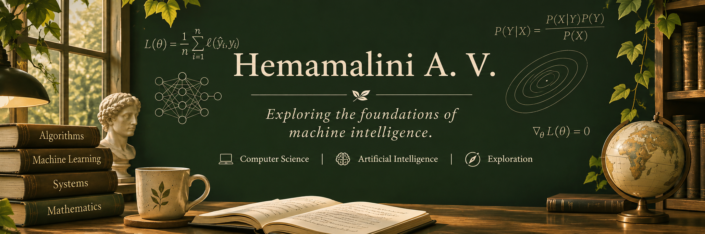

  

  COMPUTER SCIENCE & ARTIFICIAL INTELLIGENCE

<h1 align="center">Hemamalini A.V.</h1>

  Exploring the foundations of machine intelligence.

  <em>
    A Computer Science & AI undergraduate interested in
    machine learning, mathematical foundations and computational research.
  </em>

## Research interests
- Artificial Intelligence
- Machine Learning
- Mathematical foundations of AI
- Algorithms and computational theory
- Scientific research and experimentation

<h3 align="center">AREAS OF EXPLORATION</h3>

  <em>Questions, concepts and disciplines I want to understand.</em>

<table>
  <tr>
    <td width="50%">
      <h3>01 / Intelligence</h3>
      
Machine Learning 
      Artificial Intelligence 
      Neural Networks

    </td>
    <td width="50%">
      <h3>02 / Foundations</h3>
      
Discrete Mathematics 
      Algorithms 
      Computational Theory

    </td>
  </tr>
</table>

<h3 align="center">CURRENTLY EXPLORING</h3>

  Learning through programming, mathematical reasoning
  and hands-on experimentation 🌱

---

## Technical foundations

### Programming languages

